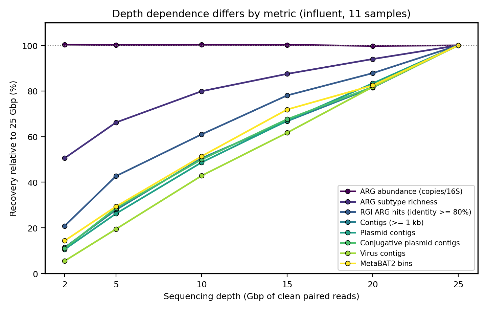
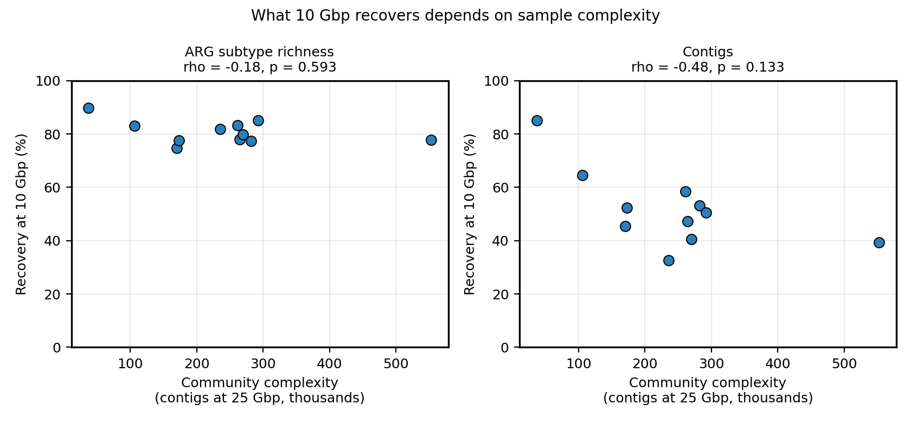
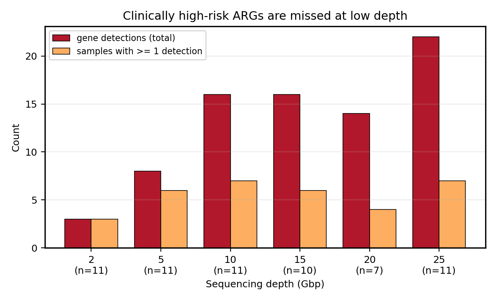
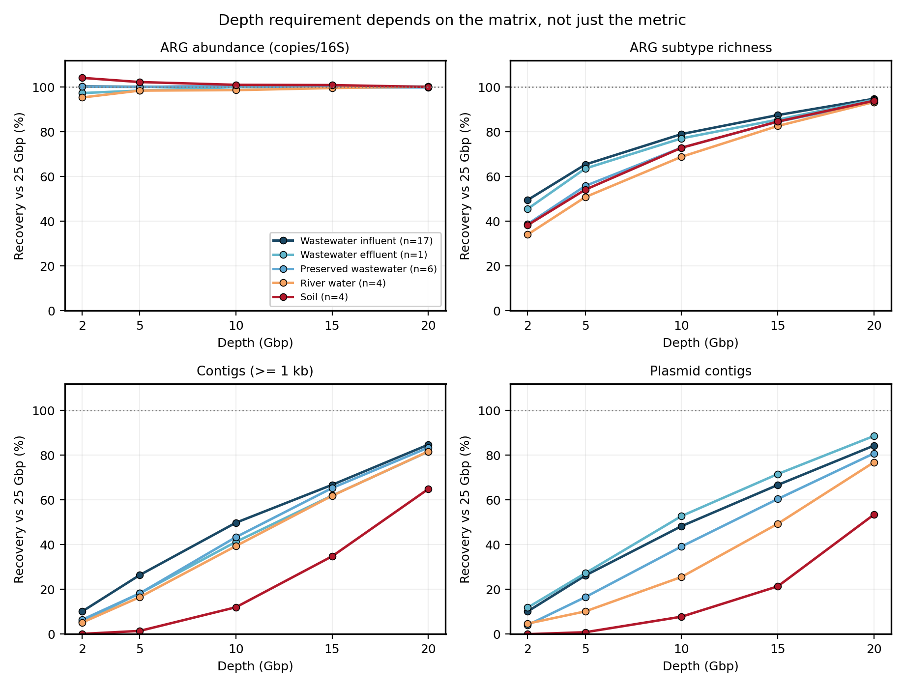
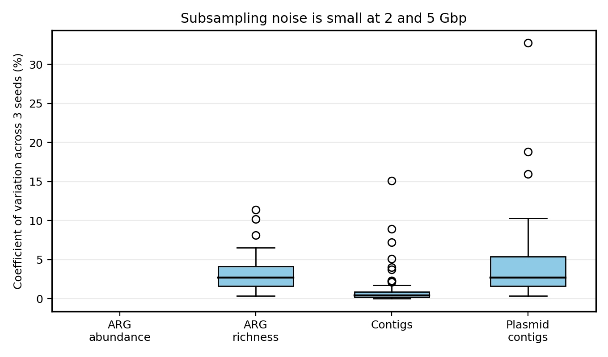

# How deep is deep enough? 污水宏基因组测序深度对 AMR 指标的影响

**Working report / 阶段性工作记录 — 2026-10-11**
Status: core set complete (32 samples, 5 matrices, 320 datasets, read-based and assembly-based
metrics). Bin quality (CheckM2, GTDB-Tk) and the two larger validation layers are still running.
状态:核心组已完成(32 个样本、5 种基质、320 个数据集,读长与组装两端指标)。bin 质量
(CheckM2、GTDB-Tk)和两个更大的验证层仍在运行。

---

## 1. The question / 研究问题

**EN.** Shotgun metagenomics is now routine in environmental AMR surveillance, but there is no
agreed sequencing depth for wastewater. Published studies use anywhere from 5 to 30 Gbp per
sample and almost none report whether their conclusions would change at a different depth. The
gap matters most for assembly-derived results (plasmids, mobile genetic elements, metagenome
assembled genomes), which are the fastest-growing part of the field.

This study answers the question the only way it can be answered cleanly: take one sample, split
its own reads into a depth ladder, run an identical pipeline at every rung, and see which numbers
move. Because every comparison is within a sample, library preparation, extraction chemistry,
sequencing batch and community composition are all held constant. Depth is the only variable.

**中文.** 鸟枪法宏基因组已经是环境 AMR 监测的常规手段,但污水样本该测多深没有共识。已发表研究
的深度从 5 到 30 Gbp 不等,几乎没有人报告"换个深度结论会不会变"。这个缺口对组装类结果
(质粒、可移动遗传元件、宏基因组组装基因组)影响最大,而这恰恰是近年增长最快的方向。

本研究用唯一干净的方式回答这个问题:取同一个样本,把它自己的 reads 抽成一个深度梯度,每一档
跑完全相同的流程,看哪些数字会变。因为所有比较都在样本内部进行,建库、提取、测序批次和群落组成
全部固定,唯一变化的就是深度。

---

## 2. Design / 设计

| | |
|---|---|
| Samples / 样本 | 32 metagenomes with clean depth >= 25 Gbp: 17 wastewater influent, 1 effluent, 6 preserved wastewater, 4 river water, 4 soil |
| Origin / 来源 | public SRA/ENA runs plus in-house Australian samples; influent draws on 17 BioProjects |
| Depth rungs / 深度档位 | 2, 5, 10, 15, 20, 25 Gbp of clean paired reads |
| Seeds / 随机种子 | 3 independent seqtk seeds at 2 and 5 Gbp, 1 elsewhere |
| Datasets / 数据集总数 | 320 |
| Reference / 参照 | the 25 Gbp rung of the same sample |

Sections 3.1 to 3.4 report the first 11 influent samples (66 datasets), where no more than two
samples came from any one BioProject. Sections 3.5 and 3.6 report the full core set.
第 3.1 到 3.4 节基于最初的 11 个进水样本(66 个数据集),当时每个 BioProject 最多取 2 个样本;
第 3.5 和 3.6 节基于完整的核心组。

The full pipeline at every rung: seqtk subsampling, ARGs-OAP (read-based ARG abundance),
Kraken2/Bracken (taxonomy), MEGAHIT (assembly), RGI/CARD (contig-level ARGs),
geNomad (plasmids, viruses, conjugative elements), Bowtie2 + MetaBAT2 (binning).
See [METHODS.md](METHODS.md) for versions, parameters and exactly how each number is counted.

---

## 3. Headline results / 主要结果

### 3.1 Abundance is immune to depth; everything else is not
### 3.1 丰度对深度免疫,其余指标都不是

Median recovery relative to the same sample at 25 Gbp:
相对于同一样本 25 Gbp 的中位回收率:

| Depth (Gbp) | ARG abundance (copies/16S) | ARG subtype richness | RGI hits (id >=80%) | Contigs | Plasmid contigs | Conjugative | Virus contigs | Bins |
|---|---|---|---|---|---|---|---|---|
| 2  | **100%** | 51% | 21% | 11% | 11% | 11% | 5%  | 14% |
| 5  | **100%** | 66% | 43% | 28% | 26% | 29% | 19% | 29% |
| 10 | **100%** | 80% | 61% | 51% | 49% | 50% | 43% | 51% |
| 15 | **100%** | 89% | 79% | 68% | 68% | 68% | 62% | 72% |
| 20 | **100%** | 95% | 93% | 87% | 85% | 84% | 84% | 91% |

**EN.** ARG abundance normalised to 16S is flat to two decimal places across a 12.5-fold range of
depth. Every count-based metric, by contrast, is still climbing at 25 Gbp and none of them has
reached a plateau. At the depth most published wastewater studies actually use, about 10 to
14 Gbp, roughly **half** of the plasmid contigs, conjugative elements and genome bins that
25 Gbp would have found are simply absent.

**中文.** 以 16S 归一化的 ARG 丰度在 12.5 倍的深度范围内小数点后两位都不变。相比之下,所有
计数型指标到 25 Gbp 仍在上升,没有一个进入平台期。在已发表污水研究实际常用的深度(约 10 到
14 Gbp)下,25 Gbp 本可以找到的质粒 contig、接合性元件和基因组 bin,**大约有一半根本不会出现**。

### 3.2 How much 10 Gbp recovers depends on the sample
### 3.2 10 Gbp 能回收多少,取决于样本本身

| Sample | Contigs at 25 Gbp | ARG richness recovered at 10 Gbp | Contigs recovered at 10 Gbp |
|---|---|---|---|
| SRR12147797 | 37,029 | 90% | **85%** |
| ERR13731085 | 106,121 | 83% | 64% |
| ERR12510812 | 173,031 | 78% | 52% |
| ERR13731241 | 261,059 | 83% | 59% |
| SRR35672372 | 269,944 | 80% | 41% |
| SRR27197501 | 235,491 | 82% | **33%** |
| SRR35242016 | 552,726 | 78% | 39% |

**EN.** ARG subtype recovery at 10 Gbp is tightly clustered between 75% and 90% in all 11 samples,
so that part of the answer generalises. Contig recovery is not: it ranges from 33% to 85% and
tracks community complexity. A simple, cheap proxy for complexity (contig count from a shallow
run) predicts how much deeper a sample needs to go. That is more useful than a single
recommended number, because it allows a two-pass design: sequence everything shallow, then
top up only the complex samples.

**中文.** 11 个样本在 10 Gbp 的 ARG 种类回收率全部落在 75% 到 90% 之间,这一条可以推广。
contig 回收率则不然,从 33% 到 85%,并且和群落复杂度相关。复杂度可以用浅测序的 contig 数
便宜地估计出来,从而预测某个样本还需要测多深。这比给一个固定推荐值更有用,因为它支持两段式
设计:先全部浅测,再只对复杂样本补测。

### 3.3 Low depth misses the genes that matter most
### 3.3 低深度漏掉的恰恰是最要紧的基因

| Depth (Gbp) | High-risk gene detections | Samples with >=1 detection |
|---|---|---|
| 2  | 3  | 3 / 11 |
| 5  | 8  | 6 / 11 |
| 10 | 16 | 7 / 11 |
| 25 | **22** | 7 / 11 |

Genes recovered only at higher depth include **NDM-1, IMP-1, KPC-75, CTX-M-15, CTX-M-30,
MCR-4.3 and mcr-10.1**.

**EN.** Carbapenemases and mobile colistin resistance genes are exactly what a surveillance
programme exists to detect, and they are rare enough in wastewater that shallow sequencing
misses them. A programme that reports only normalised ARG abundance would conclude its depth
was adequate, while silently under-reporting carbapenemase detections by roughly 30% at 10 Gbp.

**中文.** 碳青霉烯酶和可移动黏菌素耐药基因正是监测项目最想抓到的目标,而它们在污水里足够稀有,
浅测序会漏掉。一个只报告归一化 ARG 丰度的项目会认为自己的深度够用,而实际上在 10 Gbp 下
碳青霉烯酶的检出会被低估约三成。

---

### 3.4 What is lost is not a random sample of what was there
### 3.4 丢掉的不是随机的一部分

Plasmid contigs called at 25 Gbp were used as a reference set and searched for in the assemblies
of the same sample at lower depth (minimap2, alignment identity >= 95%). Two thresholds are
reported: **strict** (alignment covers >= 80% of the reference contig, i.e. the plasmid was
rebuilt) and **lenient** (>= 30%, i.e. the plasmid was seen at all). Full output in
[`data/plasmid_fate_summary.txt`](data/plasmid_fate_summary.txt).

以 25 Gbp 检出的质粒 contig 为参照集,在同一样本较低深度的组装结果中搜索(minimap2,比对
相似度 >= 95%)。报告两个判定标准:**严格**(比对覆盖参照 contig 的 80% 以上,即质粒被完整
重建)和**宽松**(覆盖 30% 以上,即质粒被看到)。完整输出见
[`data/plasmid_fate_summary.txt`](data/plasmid_fate_summary.txt)。

Recovery at 10 Gbp, median across the 11 samples / 10 Gbp 时 11 个样本的中位回收率:

| Group / 分组 | n contigs | Strict / 严格 | Lenient / 宽松 |
|---|---|---|---|
| 1-2 kb | 8,645 | 6% | 9% |
| 2-5 kb | 21,908 | 7% | 15% |
| 5-10 kb | 9,633 | 13% | 26% |
| > 10 kb | 4,282 | **17%** | **39%** |
| carries an ARG / 携带 ARG | 290 | **19%** | **40%** |
| no ARG / 不携带 ARG | 44,178 | 10% | 18% |
| conjugative / 接合性 | 8,362 | 8% | 21% |
| non-conjugative / 非接合性 | 36,106 | 10% | 18% |

**EN.** Two things stand out. First, long plasmids survive shallow sequencing far better than
short ones: at 10 Gbp a plasmid over 10 kb is four times more likely to be detected than one of
1 to 2 kb. Second, and against expectation, **plasmids carrying an ARG are recovered about twice
as often as plasmids without one** (40% vs 18% lenient, 19% vs 10% strict), consistently at every
rung. The likely reason is not the ARG itself but its host: acquired ARGs sit disproportionately
on plasmids of abundant organisms, which are covered more deeply and assemble more easily.

This has a specific and awkward consequence. The numerator of "fraction of plasmids carrying an
ARG" falls more slowly with depth than the denominator, so **a shallow library inflates that
fraction**. At 10 Gbp the denominator retains 18% of reference plasmids while the numerator
retains 40%, so the estimated ARG-carriage rate is roughly doubled. Mobilome studies that report
plasmid-borne ARG proportions from shallow libraries are therefore biased upwards, not downwards,
even though they see fewer plasmids overall. Conjugation genes, by contrast, make almost no
difference to recovery (21% vs 18%), so conjugative elements are not unusually hard to assemble.

**中文.** 有两点值得注意。第一,长质粒在浅测序下的存活率远高于短质粒:10 Gbp 时,大于 10 kb
的质粒被检出的概率是 1 到 2 kb 质粒的四倍。第二,与预期相反,**携带 ARG 的质粒回收率约为不
携带者的两倍**(宽松标准 40% 对 18%,严格标准 19% 对 10%),且在每一档都保持这个方向。
原因很可能不是 ARG 本身,而是它的宿主:获得性 ARG 不成比例地位于高丰度菌的质粒上,这些质粒
覆盖度更高,也更容易组装。

这带来一个具体而别扭的后果。"携带 ARG 的质粒占比"这个指标,分子随深度下降的速度慢于分母,
所以**浅测序会高估这个占比**。10 Gbp 时分母保留 18%,分子保留 40%,估算出的携带率大约被
放大一倍。也就是说,基于浅测序文库报告质粒携带 ARG 比例的 mobilome 研究,偏差方向是偏高
而非偏低,尽管它们看到的质粒总数更少。相比之下,接合基因对回收率几乎没有影响(21% 对 18%),
说明接合性元件并不特别难组装。

**Caveat / 注意.** Only 290 of 44,468 reference plasmid contigs carry an ARG at identity >= 80%,
so the ARG-carriage comparison rests on a small numerator and has not yet been tested for
per-sample consistency.
44,468 条参照质粒 contig 中只有 290 条在 identity >= 80% 下携带 ARG,因此这一组比较的分子
很小,尚未检验其在各样本间是否稳定。

---

### 3.5 The depth a sample needs depends on what it is
### 3.5 一个样本需要多深,取决于它是什么

The ladder was extended to 32 samples across five matrices, with three subsampling seeds at the
2 and 5 Gbp rungs. Median recovery relative to the same sample at 25 Gbp:

梯度扩展到五种基质共 32 个样本,2 和 5 Gbp 档各用三个随机种子。相对同一样本 25 Gbp 的中位
回收率:

| Matrix / 基质 | n | Contigs @2 | @5 | @10 | @15 | Plasmid @10 |
|---|---|---|---|---|---|---|
| Wastewater influent / 污水进水 | 17 | 10% | 26% | 50% | 67% | 48% |
| Wastewater effluent / 污水出水 | 1 | 6% | 18% | 41% | 62% | 53% |
| Preserved wastewater / 加保存剂污水 | 6 | 6% | 18% | 43% | 65% | 39% |
| River water / 河水 | 4 | 5% | 17% | 39% | 62% | 26% |
| **Soil / 土壤** | 4 | **0%** | **1%** | **12%** | **35%** | **8%** |

**EN.** ARG abundance normalised to 16S holds at 95% to 104% of the full-depth value in every
matrix at every rung, so that result generalises beyond wastewater. Nothing else does. Soil is a
different problem entirely: at 5 Gbp its assembly recovers 1% of the contigs and 1% of the plasmid
contigs that 25 Gbp finds, and produces no genome bins at all. River water sits between soil and
wastewater, and is noticeably worse for plasmids (26% at 10 Gbp against 48% for influent).
Taxonomic profiling is far more robust than assembly in all matrices: Bracken species counts
reach 78% to 91% at 10 Gbp where contigs reach 12% to 50%.

The three wastewater forms (influent, effluent, and influent held with preservatives) give almost
identical curves, which is a useful negative result: adding a preservative does not change how
deep the sample needs to be sequenced.

**中文.** 以 16S 归一化的 ARG 丰度在所有基质、所有档位都维持在满深度值的 95% 到 104%,所以
这一条可以推广到污水以外。其余指标都不行。土壤完全是另一回事:5 Gbp 时它的组装只能回收
25 Gbp 所得 contig 的 1%、质粒 contig 的 1%,而且一个基因组 bin 都产不出。河水介于土壤和
污水之间,质粒回收尤其差(10 Gbp 时 26%,进水为 48%)。在所有基质中,物种分类都比组装稳健
得多:10 Gbp 时 Bracken 物种数达到 78% 到 91%,而 contig 只有 12% 到 50%。

污水的三种形态(进水、出水、加保存剂的进水)曲线几乎重合,这是一个有用的阴性结果:加保存剂
不改变该样本需要测多深。

### 3.6 Subsampling noise is small / 抽样随机性很小

Three independent seqtk seeds were run at the 2 and 5 Gbp rungs of every core sample. Median
coefficient of variation across seeds: ARG abundance 1.9%, ARG richness 2.7%, contigs 0.4%,
plasmid contigs 3.5%. The curves above are therefore not an artefact of which reads happened to
be drawn. The only large coefficients of variation come from counts near zero, which is itself the
soil and river-water result restated: at 2 Gbp those samples yield zero, one or two plasmid
contigs, so a 173% coefficient of variation describes the values 0, 0, 2.

每个核心样本的 2 和 5 Gbp 档都用三个独立的 seqtk 随机种子跑过。种子间变异系数中位数:
ARG 丰度 1.9%,ARG 种类 2.7%,contig 0.4%,质粒 contig 3.5%。所以上面的曲线不是"碰巧抽到
哪些 reads"造成的。唯一出现的大变异系数都来自接近零的计数,而那本身就是土壤和河水结果的另
一种说法:2 Gbp 时这些样本只产出 0、1 或 2 条质粒 contig,173% 的变异系数描述的是 0、0、2
这组数。

---

## 4. What this means in practice / 实践含义

**EN.**

1. If the deliverable is ARG abundance or drug-class composition, 5 to 10 Gbp is sufficient and
   spending more is waste.
2. If the deliverable is a list of which ARGs are present, 10 Gbp returns about 80% of the
   subtypes and the curve is still rising.
3. If the deliverable involves plasmids, mobility, host assignment or MAGs, 25 Gbp is not enough.
   Published mobilome and MAG results from 10 to 15 Gbp libraries are likely to be systematic
   underestimates, and the size of that underestimate depends on the sample.
4. For surveillance of clinically high-risk genes, depth is not a tuning parameter. It decides
   whether a carbapenemase is reported at all.
5. Do not carry a wastewater depth across to soil. At 5 Gbp a soil assembly returns 1% of what
   25 Gbp returns and no genome bins, so assembly-based work on soil below 10 Gbp produces
   almost nothing. River water needs more depth than wastewater for plasmids specifically.
6. Where a project only needs who is present rather than what they carry, taxonomic profiling
   survives shallow sequencing in every matrix tested.

**中文.**

1. 如果产出是 ARG 丰度或药物类别组成,5 到 10 Gbp 就够,再多是浪费。
2. 如果产出是"检出了哪些 ARG"的清单,10 Gbp 能拿到约八成 subtype,曲线仍在上升。
3. 如果产出涉及质粒、移动性、宿主归属或 MAG,25 Gbp 都不够。基于 10 到 15 Gbp 的已发表
   mobilome 和 MAG 结果很可能是系统性低估,低估幅度还随样本而变。
4. 对高风险基因的监测而言,深度不是一个可调参数,它直接决定碳青霉烯酶会不会被报出来。
5. 不要把污水的深度标准搬到土壤。5 Gbp 时土壤组装只能得到 25 Gbp 所得的 1%,且没有任何
   基因组 bin,所以低于 10 Gbp 做土壤的组装类分析几乎得不到东西。河水在质粒这一项上需要
   比污水更深。
6. 如果项目只需要知道有哪些物种、而不是它们携带什么,物种分类在所有测试过的基质里都能
   经受浅测序。

---

## 5. Known limitations / 已知问题

**EN.**

- **Effluent rests on one sample.** Only one effluent metagenome reached 25 Gbp, so the effluent
  row of section 3.5 is a single curve, not a median. Eight more effluent samples are queued at a
  15 Gbp ceiling in the next layer.
- **Soil and river water have four samples each**, all from one flood study, so matrix and study
  are confounded for those two rows.
- **MetaBAT2 returned zero bins** for two datasets (R8188_S1 at 25 Gbp, SRR23730275 at 10 Gbp)
  and those are excluded from bin statistics.
- **Bin quality is not yet assessed.** CheckM2 and GTDB-Tk have not been run, so "bins" here
  means raw MetaBAT2 output, not high-quality MAGs. The genuinely interesting number, how many
  near-complete genomes each depth yields, is still missing.
- **Influent only.** Whether the same curves hold for effluent, sludge, river water, soil and air
  is the subject of Layer 2.
- **geNomad plasmid and virus counts are contig counts**, not de-replicated element counts. They
  scale with assembly size by construction, which is part of what is being measured, but it means
  the absolute values are not comparable to studies that count elements differently.

**中文.**

- **出水只有 1 个样本。** 只有一个出水宏基因组达到 25 Gbp,所以 3.5 节出水那一行是单条曲线
  而非中位数。下一层会补 8 个出水样本,上限 15 Gbp。
- **土壤和河水各只有 4 个样本**,且全部来自同一项洪水研究,因此这两行里基质和研究是混淆的。
- **两个数据集 MetaBAT2 产出 0 个 bin**(R8188_S1 的 25 Gbp、SRR23730275 的 10 Gbp),
  已从 bin 统计中排除。
- **尚未评估 bin 质量。** CheckM2 和 GTDB-Tk 还没跑,所以这里的 bins 是 MetaBAT2 的原始
  输出,不是高质量 MAG。真正有意思的数字(每个深度能得到多少接近完整的基因组)还没有。
- **只做了进水。** 出水、污泥、河水、土壤和空气是否遵循同样的曲线,属于第二层的内容。
- **geNomad 的质粒和病毒计数是 contig 计数**,不是去冗余后的元件计数。它按定义会随组装规模
  增长,这本身正是要测量的对象,但这意味着绝对值不能和采用其他计数方式的研究直接比较。

---

## 6. Next steps / 下一步

1. Finish the 16 reruns, then recompute every table in this report. 完成 16 个重跑,重算全部表格。
2. Kraken2/Bracken for the remaining datasets; add taxonomic richness and diversity to the curves.
   补齐剩余数据集的 Kraken2/Bracken,把物种丰富度和多样性加入曲线。
3. CheckM2 and GTDB-Tk on all bins in a single pass; report high-quality MAG yield per depth.
   一次性对全部 bin 跑 CheckM2 和 GTDB-Tk,报告每个深度的高质量 MAG 产出。
4. Triplicate seeds at 2 and 5 Gbp to quantify subsampling noise. 在 2 和 5 Gbp 做三个随机种子。
5. Layer 2: the same ladder across seven matrices (influent, effluent, sludge, preserved
   wastewater, soil, river water, air). 第二层:七种基质的同一套梯度。
6. Layer 3: 176 further samples at 10 and 5 Gbp, read-based metrics only, to test whether the
   recovery ratios hold at scale. 第三层:176 个样本的 10 和 5 Gbp 两档,只做读长层面,检验
   回收率是否在更大规模上成立。

---

## 7. Repository layout / 仓库结构
data/L1_summary.tsv one row per dataset, all extracted metrics / 每个数据集一行的全部指标
figures/ the three figures in this report / 报告中的三张图
scripts/summarise_L1.py builds data/L1_summary.tsv from pipeline output / 从流程输出生成汇总表
scripts/plot_L1.py builds figures/ from data/L1_summary.tsv / 从汇总表生成图
METHODS.md versions, parameters, and how every number is counted / 版本、参数与计数方式

Raw pipeline outputs (assemblies, RGI tables, geNomad summaries, bins) are held on institutional
storage and are not in this repository because of their size.
原始流程输出(组装、RGI 表、geNomad 汇总、bin)因体积原因保存在机构存储上,不在本仓库内。
